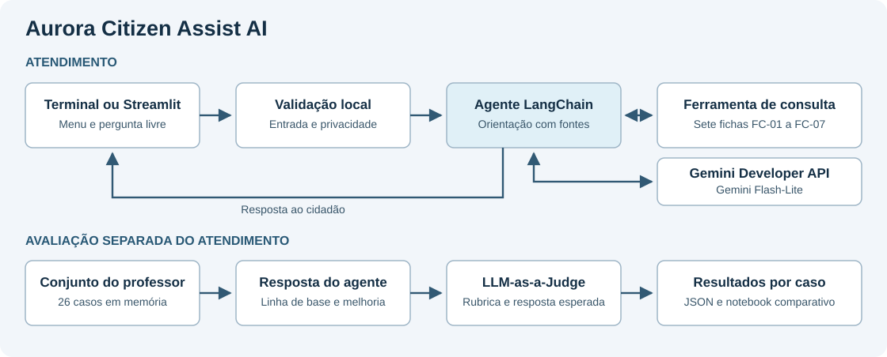

# Aurora Citizen Assist AI

**Projeto acadêmico de Prompt e Inteligência Artificial**

**Integrantes:** Caio César Portela França, Tiago Pimentel Muniz e Gustavo Curis de Francisco.

Assistente didático de orientação sobre documentos pessoais, usando informações fictícias da Central do Cidadão de Aurora. Este protótipo não é canal oficial e não deve ser usado para decisões reais.

## Executar o protótipo

Em PowerShell, na raiz do repositório, prepare o ambiente Python. O ambiente usado no projeto tem Python 3.14.7.

```powershell
py -m venv .venv
.\.venv\Scripts\python.exe -m pip install -r requirements.txt
if (-not (Test-Path .env)) { Copy-Item .env.example .env }
```

Abra o `.env` e preencha `GOOGLE_API_KEY` com a sua chave do Gemini Developer API. Guarde a chave somente nesse arquivo local.

```powershell
.\.venv\Scripts\python.exe -m streamlit run streamlit_app.py
```

Para usar o terminal, execute `.\.venv\Scripts\python.exe main.py`. O Streamlit oferece menu por tema, chat e consulta aos resultados da avaliação. A preparação no PyCharm e a resolução de erros estão em [ambientes.md](ambientes.md).

## Arquitetura



## Fonte de conhecimento

As fichas FC-01 a FC-07 em [`data/fichas/`](data/fichas/) são a única fonte de verdade do agente. Valores, prazos e regras são inventados para a atividade; não representam serviços ou legislação reais. Se uma informação não estiver nas fichas, o agente não deve inventar.

Uma ferramenta do agente lê as sete fichas em Markdown durante a consulta. O Python verifica a entrada e bloqueia padrões comuns de dados pessoais antes de enviar perguntas ao Gemini. O modelo usa as fichas para redigir a orientação e indicar as fontes.

## Escolhas, melhorias e limites

O LangChain foi escolhido para ligar um agente à ferramenta de consulta. Um único agente é suficiente para as sete fichas, que cabem juntas no contexto. A leitura direta facilita a inspeção da base. O Gemini Developer API no plano gratuito foi a opção do grupo para executar o protótipo. O modelo Flash-Lite respondeu aos testes locais depois de uma falha de disponibilidade na opção anterior.

Depois da linha de base, o grupo passou a exigir que cada afirmação fosse sustentada pelo conjunto de fichas e que as versões fossem conferidas nos arquivos. Também refinou o tratamento de recusa e privacidade e a conferência das citações pelo juiz. As regras dos serviços continuam nas fichas, em vez de serem repetidas no prompt.

O assistente não executa serviços públicos, agendamentos ou consultas cadastrais. Perguntas ausentes das fichas ficam sem resposta factual. O chat exibe a conversa da sessão, mas o modelo recebe a pergunta atual, de modo que perguntas de seguimento podem precisar mencionar novamente o assunto. O acesso ao Gemini depende de internet, chave e quota.

## Documentos do projeto

- [`AGENTS.md`](AGENTS.md): regras para trabalhar neste repositório.
- [`PRD.md`](PRD.md): escopo, requisitos e decisões confirmadas.
- [`workflow.md`](workflow.md): etapas e critérios acadêmicos.
- [`currentstate.md`](currentstate.md): progresso e próximo passo.
- [`ambientes.md`](ambientes.md): preparação do ambiente, execução e uso seguro da chave da API.
- [`prompt.md`](prompt.md): contexto curto para retomadas.

## Avaliação e entrega acadêmica

A referência principal é `ENUNCIADO_Prompt_IA.docx`, seção específica de Prompt e IA no pacote acadêmico fornecido. O enunciado exige framework de agentes, LLM, avaliação dos 26 casos com LLM-as-a-Judge, melhoria comparativa, proteção de dados e testes com usuários. A arquitetura inicial é LangChain com um agente e Gemini API na faixa gratuita; `gemini-3.5-flash-lite` respondeu no teste do protótipo.

O botão **Exibir resultados salvos** funciona com os resultados incluídos. Para retomar o julgamento ou carregar a coluna de respostas esperadas, coloque o arquivo original `GS_2026_2_CitizenTech_VERSAO_FINAL_CONSOLIDADA.zip` na pasta `Downloads` do usuário. O [avaliador](avaliacao/avaliar.py) lê em memória os 26 casos do professor, usa um juiz separado e salva apenas respostas e julgamentos por ID.

Os resultados do juiz foram **20/26 na linha de base** e **26/26 na rodada aprimorada**. O [notebook comparativo com as saídas salvas](avaliacao/relatorio_comparativo_v6.ipynb) apresenta os resultados e a análise dos erros. Os registros estão em [linha de base](avaliacao/resultados/baseline.json) e [versão aprimorada](avaliacao/resultados/aprimorada_validada.json).

O [relatório de testes com usuários](avaliacao/relatorio_testes_usuarios.md) consolida três tarefas por pessoa, uma tarefa adicional e os questionários de cinco pessoas externas. O relatório explica como os tempos foram estimados.
